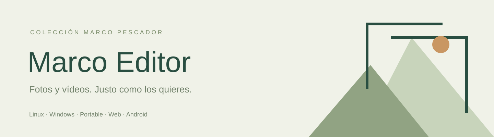

  

<strong>Recorta y gira fotos y vídeos. Quédate con la mejor parte y guarda una copia.</strong> Linux · Windows · Portable · Web · Android

<a href="https://marco-editor.peskysa.chatgpt.site"><strong>Abrir aplicación web</strong></a> · <a href="https://github.com/Peskysa/marco-editor/releases/latest">Descargas</a> · <a href="docs/README.md">Documentación</a> · <a href="https://github.com/Peskysa/marco-editor/issues">Ayuda</a>

## La aplicación

Un editor sencillo de **Marco Pescador** para los pequeños cambios del día a día. Una sola ventana para fotos y vídeos, con vista previa, recorte libre o por proporciones, giro de 90°, reflejo horizontal y copia nueva. Sin cuentas, anuncios ni envío de los archivos a un servidor.

## Cinco modalidades

| Modalidad | Descarga | Uso |
| --- | --- | --- |
| **Linux** | [Marco-Editor-Linux-amd64.deb](https://github.com/Peskysa/marco-editor/releases/download/v1.0.0/Marco-Editor-Linux-amd64.deb) | DEB para amd64; también TAR.GZ portable. |
| **Windows** | [Marco-Editor-Windows-Instalador.exe](https://github.com/Peskysa/marco-editor/releases/download/v1.0.0/Marco-Editor-Windows-Instalador.exe) | Instalador para el usuario actual, x64. |
| **Portable** | [Marco-Editor-Portable.exe](https://github.com/Peskysa/marco-editor/releases/download/v1.0.0/Marco-Editor-Portable.exe) | Ejecutable Windows sin instalar. |
| **Web** | [Marco-Editor-Web.zip](https://github.com/Peskysa/marco-editor/releases/download/v1.0.0/Marco-Editor-Web.zip) | Web autónoma para HTTPS o servidor local. |
| **Android** | [Marco-Editor-Android.apk](https://github.com/Peskysa/marco-editor/releases/download/v1.0.0/Marco-Editor-Android.apk) | APK firmado con clave estable propia. |

También se adjuntan `Marco-Editor-Web-Portable.exe`, `Marco-Editor-Linux-Portable.tar.gz`, documentación, fuente del mismo commit, fuentes de terceros y `SHA256SUMS.txt`. Los paquetes compilados incluyen sus recursos; el usuario no necesita Python ni Node.js para utilizarlos.

Portable sigue sujeto a los permisos del equipo. Los ejecutables Windows no tienen firma comercial. El APK se instala fuera de Google Play. **No verificado en teléfono físico**; las capturas móviles corresponden a una pantalla simulada en navegador. [Distribución y comprobaciones](docs/DISTRIBUCION.md).

## Funciones

- Fotos: recorte libre, cuadrado, 16:9, 9:16, 4:3 u original; giro, reflejo, deshacer encuadre y exportación JPG, PNG o WebP.
- Vídeos: las mismas herramientas de encuadre; conservar un tramo, quitarlo y unir sus extremos, o dividir en dos mitades.
- Exportación MP4 con H.264 y audio AAC; opción de quitar el sonido y limitar a 720p o 1080p.
- Vista previa del resultado y descarga explícita. En Android, menú para guardar o compartir.
- Archivos procesados localmente. La web puede trabajar sin conexión después de cargar los recursos necesarios.

## Capturas

Capturas auténticas con ejemplos originales. [Galería y reproducción](docs/CAPTURAS.md).

## Instalación y uso

Abre la web o descarga el paquete de tu sistema, comprueba su SHA-256 y sigue [Instalación](docs/INSTALACION.md). Abre un archivo, realiza los cambios y pulsa **Guardar copia**. Revisa la vista previa y descarga el resultado. El original no se sobrescribe.

## Documentación

- [Instalación](docs/INSTALACION.md), [manual](docs/MANUAL.md) y [distribución](docs/DISTRIBUCION.md).
- [Capturas](docs/CAPTURAS.md), [desarrollo](docs/DESARROLLO.md) y [privacidad](docs/PRIVACIDAD.md).
- [Licencia](docs/LICENCIA.md), [terceros](THIRD_PARTY.md) e [historial](CHANGELOG.md).
- [Contribuir](CONTRIBUTING.md) y [seguridad](SECURITY.md).

## Desarrollo y comprobaciones

Pruebas de rangos, coordenadas y exportación, además de pruebas en navegador con lectura de píxeles, decodificación real de vídeo y comprobación de audio. Los paquetes se compilan por sistema en Actions, se comprueba la aplicación empaquetada y solo después se publica la versión. Ver [Desarrollo](docs/DESARROLLO.md).

## Alcance y límites

Interfaz en español. Hasta 200 MB por archivo y 40 millones de píxeles. Abre los formatos que pueda previsualizar el navegador del sistema; MP4/H.264 y WebM son los recomendados. GIF se convierte a imagen fija. El vídeo se recodifica a 30 fps: los cortes tienen precisión de un fotograma, las dimensiones son pares y puede haber una pequeña tolerancia en la duración por los paquetes de audio. La resolución original puede consumir mucha memoria; convienen clips cortos en móvil. No hay multipista, efectos, edición RAW, HEIC garantizado ni unión de archivos diferentes. Las fotos exportadas no conservan EXIF; PNG/WebP conservan la transparencia cuando procede. El motor de vídeo ocupa unos 32 MB y funciona en un solo hilo para ampliar compatibilidad.

## Licencia y autoría

Copyright © 2026 **Marco Pescador**. Código e identidad visual originales bajo [GNU AGPL versión 3 exclusivamente](LICENSE), `AGPL-3.0-only`, sin garantía. Las dependencias conservan sus licencias y autores. [Detalles y código fuente](docs/LICENCIA.md).
