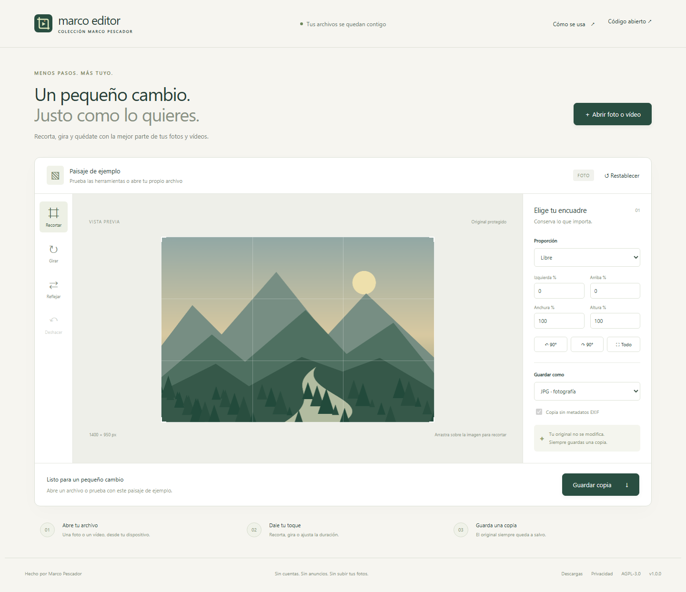
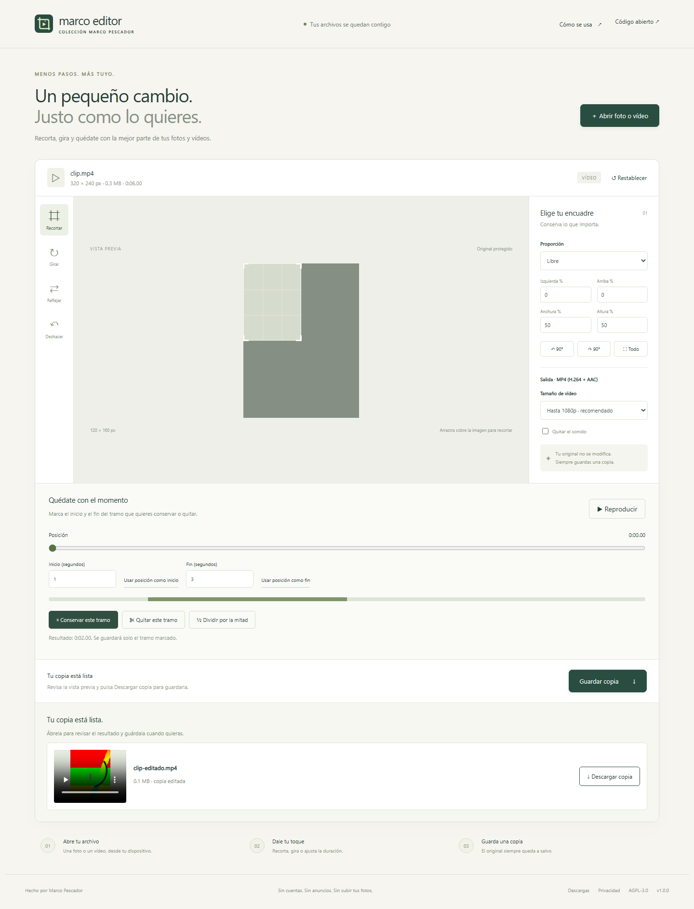
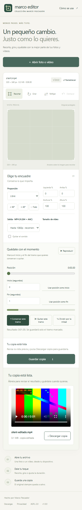

# Capturas reales

Las imágenes se obtienen con `tests/browser.cjs` sobre la aplicación ejecutada en navegador. No son maquetas ni imágenes de otro programa.

- `escritorio.png`: editor con ilustración de ejemplo original, pantalla 1440 × 1100.
- `funcion.png`: vídeo generado para pruebas, girado y recortado, con copia MP4 exportada.
- `movil.png`: interfaz con pantalla de 390 × 844 simulada en navegador. No es una captura de Android físico.

